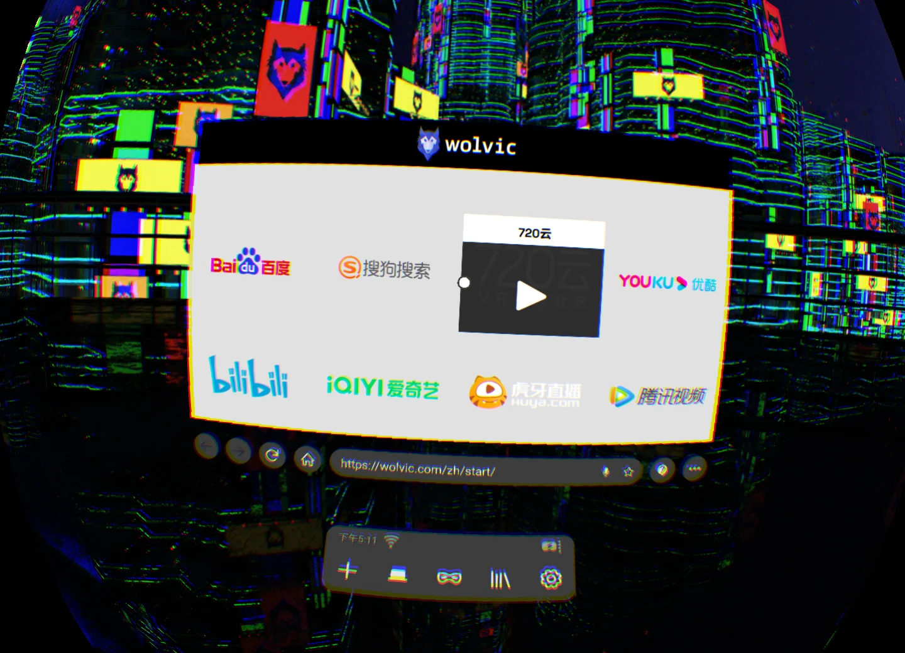

# Wolvic for Pico G2: Web, WebXR and VR Video Browser

[简体中文](README.md) | English

An unofficial **Pico G2 / Pico G2 4K** browser port based on Wolvic 1.6.2,
**GeckoView 128** and the headset's **legacy native PicoVR backend**.
It retains 3DoF tracking and controller input and offers a community
Firefox Reality alternative for this older headset.

The work goes beyond replacing the web engine: it fixes persistent video
cropping and projection-switch white screens, hands supported web players
over to native projection, repairs invisible immersive controls on specific
player paths and adds same-video codec selection through player/protocol APIs.

**[Download current APK, source and checksums](https://github.com/C-Y-T-258/wolvic-pico-g2-port/releases/tag/picog2-1.6.2-20261113)**
| **[Project website](https://c-y-t-258.github.io/wolvic-pico-g2-port/en/)**
| [Install / rollback](docs/INSTALL_ROLLBACK_20261113.md)
| [Evidence matrix](docs/RELEASE_20261113.md)

This is a community port, unaffiliated with Wolvic, Igalia or PICO.
It uses legacy PicoVR, rather than the current `picoxr` OpenXR backend.

## What Changed for Pico G2

| Problem | Change | Evidence |
| --- | --- | --- |
| An older Firefox Reality engine cannot handle some modern web and VR video paths | Restored the native G2 backend and integrated GeckoView 128 | Historical headset display, tracking, controller, WebXR session and video-texture acceptance |
| Video stays cropped at the right/bottom, or turns white after changing projection | Corrected early Surface resizing and waiting order | Historical XVideos normal/fullscreen playback and projection regression checks |
| A web VR player remains a page window, or native handoff produces black video | Media/renderer-aware handoff from the page to native video projection | Historical Hamezo Video.js VR acceptance; not proof for unknown renderers |
| Some non-desktop pages do not offer a usable immersive entry | Current-page Quest/Oculus UA fallback and reload, restored after leaving | Historical Pornhub / YouPorn checks; not universal immersive support |
| Immersive control icons are black and must be found blindly | Shared MGP SVG / CanvasTexture compatibility, including YouPorn's missing VR activation marker | User acceptance for YouPorn and related regression checks |
| Native dropdown rows flicker under the controller pointer | Corrected shared choice-widget hover propagation | User acceptance for hover, selection, click and shared-control regression |
| A page offers different codecs without an accessible browser switch | Player/protocol discovery, verified same-content candidates and switching with state protection/recovery | Natural Eporner H.264 / AV1 switching in both directions; other paths have separate evidence levels |

These are results for particular paths, not universal website or VR-combination
acceptance. See the release boundary below and the [full matrix](docs/RELEASE_20261113.md).

## Current Download and Installation

The **2026-11-13 build** was published on **2026-11-18 (Asia/Shanghai)** as a
community prerelease. Its Release includes the APK, source patch bundle and
`SHA256SUMS.txt`.

| Item | Current build |
| --- | --- |
| App label | Wolvic Pico G2 |
| APK | `Wolvic-1.6.2-picog2-20261113-arm64-signed.apk` |
| Version | `1.6.2-picog2-20261113` |
| versionCode | `203170001` |
| Package | `io.github.cyt258.wolvic.picog2.stage2epagequestua` |
| ABI | arm64-v8a |
| APK SHA256 | `AFA8E6451E1E5F5871497729A161F7834606E6FE2612281A59B1F55C42A8B950` |

Download in the headset browser and open the APK from Downloads or a file
manager using Android's installer. Alternatively, download and verify it on a
computer, transfer it by USB/MTP, or install using ADB:

```powershell
Get-FileHash .\Wolvic-1.6.2-picog2-20261113-arm64-signed.apk -Algorithm SHA256
adb devices
adb install -r .\Wolvic-1.6.2-picog2-20261113-arm64-signed.apk
```

Launch **Wolvic Pico G2**. Android may ask you to allow the installation source.
For multiple connected devices, add `-s SERIAL` after `adb`.

This APK updates earlier test candidates with the same package and signer.
It coexists with 0052 and Firefox Reality; their browser data is separate
and not automatically migrated. Do not uninstall just to bypass a signature
error: uninstalling deletes that package's local data.

Relative to the final tested functional baseline, this APK only changes the
app label and version metadata. Functional assets and native libraries match
byte for byte, with build, signature and static verification complete.
**The relabelled APK has not had a separate headset installation pass.**
Historical acceptance must not be presented as a full rerun of this APK.
See the [release audit](docs/RELEASE_AUDIT_20261113.md).

## Using the Video Tools

1. Open a video page and start it with the website's own play control.
2. From the ordinary browser page, open **VR Video Tools** in the extension entry.
3. Select native 2D, 180°, 360° or left/right / top/bottom stereo projection
   to match the video. Flat 3D also has automatic, single-eye and original
   aspect choices. Unknown or special projections may not map correctly.
4. To use a site's immersive player, use its VR entry. Some pages need desktop
   mode or a current-page Quest/Oculus UA fallback followed by a reload.
5. **Media sources** appears only when verified codec alternatives exist.
   Choose a target and check the reported switch result.

Page fullscreen, site immersive VR and Wolvic native projection are distinct
paths. Operate the extension from the ordinary page, without searching for it
inside fullscreen or immersive VR. After native handoff removes a supported
page renderer's listeners, its own VR button may need a page refresh to recover.

### When the Codec Menu Appears

The menu requires at least **two confirmed playable, switchable codec families
for the same video**, such as H.264 and AV1. H.264 at 480p, 720p and 1080p
is still one codec. Single codecs, unknown codecs, ambiguous identity and
unsupported playback stay hidden instead of producing an empty selector.

Discovery uses explicit HTML sources, Video.js/VHS, hls.js, dash.js, Shaka,
MGP, Delight and reusable xPlayer source-controller APIs. Detecting a library
does not prove that the video has two codecs, or that every site using it works.

Switches save playback position, play/pause, rate, volume and mute state,
verify the target and attempt recovery on failure. Unconfirmed results are
reported, and older operations must not override newer user input.
Different audio/subtitle tracks, quality mappings and VR combinations still
have incomplete validation.

Site quality and adaptive bitrate remain under the site's player.
**Bilibili keeps its own controls.** Codec switching is not a performance
guarantee: resolution, bitrate, network and device decoding capability matter.

## Tested Scope

| Path | Evidence | Boundary |
| --- | --- | --- |
| Eporner / Video.js/VHS dual HLS | Natural same-video H.264 / AV1 device switching in both directions on the final functional baseline | One manifest timeout; no guarantee for every video or connection |
| xHamster / xPlayer | Historical natural dual-codec and quality-mode tests | Not completely rerun in the final APK; the video must offer two codecs |
| HTML, hls.js, dash.js | Controlled device switching, state, interruption and recovery tests | Not proof of arbitrary natural-site support |
| Shaka, MGP, Delight | Graded evidence from controlled switching, natural binding and source discovery | Natural dual codecs, non-default audio, quality mapping and VR combinations have gaps |
| Ordinary pages and existing VR/projection | Historical user regression and device records | No final matrix of every new adapter with VR |

Four patches were replayed from clean upstream source, with 1,367 source files
compared and 28 extension files matching the APK. The extension suite has
**435 passing tests**. Source and automated checks do not replace headset
verification of sound, picture and interaction.

## Devices and Known Limits

- Target: Pico G2 / G2 4K family; tested on Android 8.1 / API 27, arm64-v8a.
  Pico 4, Neo, G3, Quest and ordinary Android phones are unverified.
- 3DoF head tracking and Pico controller input; no claims for hand, eye,
  face or body tracking or mixed reality.
- Fisheye, EAC, cubemap, arbitrary field of view and complete spatial-video
  metadata are outside the verified native projection scope.
- Entering or leaving fullscreen can briefly change aspect; historical device
  checks settled correctly.
- Long media experiments once exhausted codec/Surface resources. Rebooting
  recovered playback; this is not a confirmed permanent fix. Check networking
  separately when video fails.
- Websites change independently. DRM, unknown self-rendered players and all
  cross-origin embed combinations are not universally supported.

## 0052 Fallback

The **[historical 0052 release](https://github.com/C-Y-T-258/wolvic-pico-g2-port/releases/tag/picog2-1.6.2-0052)**
remains available. It contains the native backend, WebXR video compatibility
and early projection fixes, without the later complete codec tools.
Its package is `io.github.cyt258.wolvic.picog2`, so it can coexist with the
current build. Launch it directly if already installed.

0052 APK SHA256:
`CC1736358B02ABD98FE6AEF9E10A8203C1EA8B5BFA9B8BDAFB6157492AB929F3`.
Android may reject same-package downgrades; `-r -d` cannot guarantee a
data-preserving rollback. See [installation and rollback](docs/INSTALL_ROLLBACK_20261113.md).

## Running on the Headset



This authentic historical build 0037 capture shows the port running on the
headset. It is not the current tools UI or evidence of new compatibility.
Current capability claims follow the descriptions above and the dated
[verification record](docs/VERIFICATION.md).

## Build from Source

The source is provided as **upstream Wolvic v1.6.2 + four ordered patches +
build tooling**, rather than a separately maintained full upstream mirror.
The Release source attachment is its publication snapshot; subsequent README
updates are on `main`.

Requirements: JDK 17, Gradle 8.2 / Android Gradle Plugin 8.2.1, Android SDK 34,
NDK 25.1.8937393 (r25b), CMake 3.22.1, and a PicoVR Android Native SDK v1.3.3
AAR obtained under its license.

```powershell
git clone --branch v1.6.2 --recurse-submodules https://github.com/Igalia/wolvic.git D:\work\wolvic-v1.6.2
git -C D:\work\wolvic-v1.6.2 config core.autocrlf false

.\build.ps1 `
  -RepoPath D:\work\wolvic-v1.6.2 `
  -WorkspaceRoot D:\work\wolvic-build `
  -PicoSdkAar D:\private\PvrSDK-Native-release.aar `
  -JavaHome D:\tools\jdk-17 `
  -GradleBat D:\tools\gradle-8.2\bin\gradle.bat `
  -AndroidSdk C:\Android\Sdk `
  -NdkPath D:\tools\android-ndk-r25b `
  -Variant Release
```

The release variant is unsigned without a signing configuration and cannot be
installed directly. See [SDK requirements](docs/PICO_SDK.md) and the
[source replay / asset audit](docs/RELEASE_AUDIT_20261113.md).

| Path | Contents |
| --- | --- |
| `patches/0001` through `0004` | Native port, Surface fixes, compatibility menu and later video/codec work |
| `build.ps1`, `verify-source.cjs` | Build and extension-asset verification |
| `docs/` | Release, installation, verification and SDK boundaries |
| `site/`, `tools/` | Bilingual static showcase, generation and validation |

## License and Feedback

Wolvic-derived source and patches are MPL-2.0; third-party components retain
their licenses. The APK includes required third-party runtimes. Standalone
Pico SDK AARs, unpacked SDK files, signing keys, credentials and private
browsing logs are not distributed. Wolvic marks belong to their owners.

Use [GitHub Issues](https://github.com/C-Y-T-258/wolvic-pico-g2-port/issues),
including build, device, page/site-VR/native-projection path, reproduction
steps and actual behavior. Do not post cookies, account details or media URLs
containing private tokens.

The repository and website provide public bilingual descriptions and search
metadata. Actual search observations and unconfirmed indexing / AI
recommendations are recorded in the [discovery check](docs/DISCOVERY_CHECK_20261118.md).
