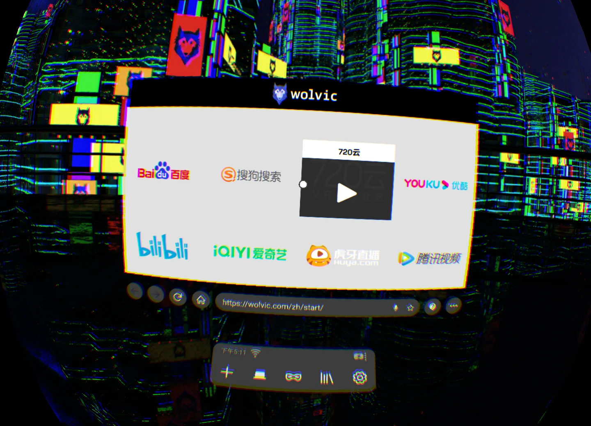

# Pico G2 版 Wolvic：网页、WebXR 与 VR 视频浏览器

简体中文 | [English](README.en.md)

为 **Pico G2 / Pico G2 4K** 移植的非官方 Wolvic 浏览器。基于 Wolvic 1.6.2、
**GeckoView 128** 和旧设备的**原生 PicoVR 后端**，保留 3DoF 头部追踪与手柄操作，
可作为这款头显上的 Firefox Reality 替代浏览器。

项目不只更新网页引擎，还围绕实际观影修复了视频裁切、投影切换白屏、网页播放器
向原生投影的交接，以及部分网站沉浸控件不可见的问题，并加入按播放器和协议
识别的同视频多编码选择。

**[下载当前版 APK、源码与校验文件](https://github.com/C-Y-T-258/wolvic-pico-g2-port/releases/tag/picog2-1.6.2-20261113)**
| **[成果展示网页](https://c-y-t-258.github.io/wolvic-pico-g2-port/)**
| [安装与回滚](docs/INSTALL_ROLLBACK_20261113.md)
| [验证范围](docs/RELEASE_20261113.md)

这是社区移植，不是 Wolvic、Igalia 或 PICO 官方发行版。它使用 legacy PicoVR，
不是新款头显使用的 `picoxr` OpenXR 后端。

## 为 Pico G2 做了哪些适配

| 实际问题 | 本项目的改动 | 验证范围 |
| --- | --- | --- |
| Firefox Reality 的旧网页引擎无法兼容部分现代网页和 VR 视频 | 恢复 Wolvic 的 Pico G2 原生设备后端，接入 GeckoView 128 | 有 Pico G2 显示、追踪、手柄、WebXR 会话与视频纹理实机记录 |
| 全屏后画面右侧、下侧持续裁切，切换投影出现白屏 | 修正视频 Surface 的早期尺寸更新与等待顺序 | XVideos 普通播放、全屏和投影切换已有历史实机回归 |
| 网页里的 VR 播放器仍是小窗口，原生投影交接后黑屏 | 通用视频工具按媒体和渲染器归属执行网页到原生投影的交接 | Hamezo 的 Video.js VR 路径有历史实机验收；未知渲染器不能据此宣称支持 |
| 部分网站非桌面模式下不提供可用沉浸入口 | 提供当前页 Quest/Oculus UA 回退，重新加载该页；离开后恢复 | Pornhub / YouPorn 路径有历史实机验证；不是所有网站自动获得沉浸能力 |
| Pornhub / YouPorn 沉浸控制栏图标黑色、需要盲找 | 共享 MGP SVG / CanvasTexture 控件兼容层，补足 YouPorn 的 VR 激活判据 | YouPorn 修复及相关回归已有用户确认；网站更新仍可能改变行为 |
| 原生下拉选项在手柄悬停时闪烁 | 修复共用选择控件的 hover 状态传播 | 悬停、选中、点击及共用菜单回归已有用户验收 |
| 网站选择的编码不合适，但浏览器没有可控切换入口 | 按播放器 / 协议发现同内容来源，确认编码后执行带状态保护、验证和恢复的切换 | Eporner 有 H.264 / AV1 自然网页双向实机证据；其他路线的证据等级分别列明 |

这些是具体路径的结果，不代表所有网站或所有 VR 组合均已通过。功能基线和
发布 APK 的区别见下方版本说明，详细测试与缺口见[覆盖表](docs/RELEASE_20261113.md)。

## 当前下载与安装

当前公开版本是 **2026-11-13 构建**，于 **2026-11-18（北京时间）**发布为社区
prerelease。Release 附 APK、源码补丁包和 `SHA256SUMS.txt`。

| 项目 | 当前版 |
| --- | --- |
| 应用名称 | Wolvic Pico G2 |
| APK | `Wolvic-1.6.2-picog2-20261113-arm64-signed.apk` |
| 版本 | `1.6.2-picog2-20261113` |
| versionCode | `203170001` |
| 包名 | `io.github.cyt258.wolvic.picog2.stage2epagequestua` |
| 架构 | arm64-v8a |
| APK SHA256 | `AFA8E6451E1E5F5871497729A161F7834606E6FE2612281A59B1F55C42A8B950` |

可以在头显浏览器打开 Release，下载后从“下载”或文件管理器打开 APK，
使用系统安装器安装。也可以先在电脑下载并校验，再用 USB/MTP 传入头显，
或通过 ADB 安装：

```powershell
Get-FileHash .\Wolvic-1.6.2-picog2-20261113-arm64-signed.apk -Algorithm SHA256
adb devices
adb install -r .\Wolvic-1.6.2-picog2-20261113-arm64-signed.apk
```

在应用列表打开 **Wolvic Pico G2**。系统安装器可能要求允许该安装来源。
连接多台设备时，在 `adb` 后加 `-s 设备序列号`。

本包可覆盖相同签名、相同包名的旧测试候选；它与 0052、Firefox Reality
使用不同包名，可以并存，浏览数据不共享、不自动迁移。不要仅为绕过签名错误
而卸载应用，卸载会删除该包的数据。

发布 APK 相对最终测试功能基线只清理了应用名称与版本标识，功能资源和原生库
逐字节一致，已完成构建、签名与静态审计。**这个新名称 APK 没有另行头显安装验收**，
不能把历史功能验收写成该 APK 重新全测通过。见[发布审计](docs/RELEASE_AUDIT_20261113.md)。

## 视频工具怎么用

1. 打开视频页面，先用网站自己的播放按钮启动视频。
2. 在普通网页界面从浏览器扩展入口打开 **VR 视频工具**。
3. 根据视频布局选择原生 2D、180°、360° 或左右 / 上下立体投影；平面 3D
   还提供自动、单眼或原始比例选择。未知或特殊投影不能保证正确映射。
4. 如果要用网站自己的沉浸播放器，使用网站 VR 入口。部分页面需要桌面模式，
   或在工具中使用当前页 Quest/Oculus UA 回退后重新加载。
5. 页面满足多编码条件时才会出现“媒体来源”，选择目标后查看实际切换结果。

**网页全屏、网站沉浸 VR 和 Wolvic 原生投影是三条不同路径。**扩展应在普通网页
界面操作，不需要在网站全屏或沉浸状态下寻找扩展按钮。原生接管某些网页渲染器后，
网站自己的 VR 按钮可能需要刷新页面才能恢复。

### 为什么有些视频没有“媒体来源”

菜单只在确认**同一视频至少有两种设备可播放、可切换的真实编码族**时出现。
例如 H.264 和 AV1；同为 H.264 的 480p、720p、1080p 不算三种编码。
只有单编码、编码未知、身份关联不清或设备能力不符时隐藏，不留下空选择框。

来源通过 HTML 显式 source、Video.js/VHS、hls.js、dash.js、Shaka、MGP、
Delight 和可复用的 xPlayer 来源控制器等接口发现。识别到播放器库不等于该视频
有双编码；实现了适配器也不等于任意使用该库的网站均可切换。

切换会保存播放位置、播放 / 暂停、倍速、音量和静音状态，并检查新来源是否生效；
失败走恢复路径，无法确认时明确报告，较新的用户操作不能被旧事务覆盖。
不同音轨、字幕、清晰度映射及 VR 组合仍有未完成验证的情况。

站内清晰度和自适应码率仍由网站播放器管理；**B站继续使用站内控制**。
切换能力不等于性能承诺，AV1 或 H.264 哪个更流畅仍取决于规格、网络和设备。

## 验证到了哪里

| 路线 | 现有证据 | 保留的限制 |
| --- | --- | --- |
| Eporner / Video.js/VHS 双 HLS | 最终功能基线同视频 H.264 / AV1 双向实机成功 | 有一次清单超时失败；不保证任意视频、任意网络均成功 |
| xHamster / xPlayer | 历史自然同内容双编码与质量模式验证 | 未在最终 APK 全部重跑，视频本身必须提供双编码 |
| HTML、hls.js、dash.js | 受控设备切换、状态、中断及恢复测试 | 不是新增任意自然网站支持声明 |
| Shaka、MGP、Delight | 有受控切换及自然页面绑定 / 来源发现等分级证据 | 自然双编码、非默认音轨、质量映射及 VR 组合各有缺口 |
| 普通网页、原有 VR / 投影 | 既有用户回归及历史实机记录 | 没有覆盖所有新增适配器与 VR 的最终组合矩阵 |

四个源码补丁已从干净的上游版本重放，1367 个源码文件完成比对，28 个扩展文件
与 APK 一致，扩展测试套件 **435 项通过**。这些是源码与自动测试结果，
不能代替头显中的实际声音、画面和交互验收。

## 设备与已知限制

- 适配目标是 Pico G2 / G2 4K 系列；实测设备为 Android 8.1 / API 27、arm64-v8a。
  不宣称 Pico 4、Neo、G3、Quest 或普通 Android 手机兼容。
- 使用 3DoF 头部追踪和 Pico 手柄，不声明手势、眼动、面部、身体追踪或混合现实。
- 鱼眼、EAC、cubemap、任意视场角和完整空间视频元数据不在已验证原生投影范围内。
- 进入 / 退出全屏可能短暂改变比例；历史实测最终画面恢复正常。
- 长时间反复媒体实验曾出现 codec / Surface 资源状态异常；完整重启头显恢复，
  但不是已确认的永久修复。视频无法播放时也应分别检查网络和解码。
- 网站可以独立更新。DRM、未知自绘渲染器和所有跨域嵌入组合不作通用兼容承诺。

## 回退到 0052

**[0052 历史版本下载](https://github.com/C-Y-T-258/wolvic-pico-g2-port/releases/tag/picog2-1.6.2-0052)**
继续保留。它包含原生后端、WebXR 视频兼容和早期投影修复，没有后续完整编码工具。
其包名为 `io.github.cyt258.wolvic.picog2`，可与当前版并存；已经安装时直接打开即可。

0052 APK SHA256：
`CC1736358B02ABD98FE6AEF9E10A8203C1EA8B5BFA9B8BDAFB6157492AB929F3`。
Android 可能拒绝同包名的降级安装，不能保证 `-r -d` 保留数据回滚。
更多细节见[安装与回滚](docs/INSTALL_ROLLBACK_20261113.md)。

## 实机运行画面



这是历史 0037 构建的真实头显启动截图，只展示移植已在设备中运行，
不冒充当前工具界面或最新兼容性验收。新版成果以以上说明和带日期的
[验证记录](docs/VERIFICATION.md)为准。

## 从源码构建

仓库以 **Wolvic v1.6.2 上游源码 + 四个有序补丁 + 构建脚本**提供本移植的源码。
不是独立维护的上游完整镜像；公开 Release 的源码附件对应发布时快照，
后续 README 更新以 `main` 为准。

构建需要 JDK 17、Gradle 8.2 / Android Gradle Plugin 8.2.1、Android SDK 34、
NDK 25.1.8937393（r25b）、CMake 3.22.1，以及你已取得并接受许可的
PicoVR Android Native SDK v1.3.3 AAR。

```powershell
git clone --branch v1.6.2 --recurse-submodules https://github.com/Igalia/wolvic.git D:\work\wolvic-v1.6.2
git -C D:\work\wolvic-v1.6.2 config core.autocrlf false

.\build.ps1 `
  -RepoPath D:\work\wolvic-v1.6.2 `
  -WorkspaceRoot D:\work\wolvic-build `
  -PicoSdkAar D:\private\PvrSDK-Native-release.aar `
  -JavaHome D:\tools\jdk-17 `
  -GradleBat D:\tools\gradle-8.2\bin\gradle.bat `
  -AndroidSdk C:\Android\Sdk `
  -NdkPath D:\tools\android-ndk-r25b `
  -Variant Release
```

未提供签名配置时，release 变体输出未签名 APK，不能直接安装。SDK 校验与边界见
[Pico SDK 说明](docs/PICO_SDK.md)，补丁重放和资源核对见[发布审计](docs/RELEASE_AUDIT_20261113.md)。

| 路径 | 内容 |
| --- | --- |
| `patches/0001` 至 `0004` | 原生移植、Surface 修复、兼容菜单及后续视频 / 编码功能 |
| `build.ps1`、`verify-source.cjs` | 构建与扩展资源核对 |
| `docs/` | 发布说明、安装回滚、验证记录与 SDK 边界 |
| `site/`、`tools/` | 中英静态展示网页及生成 / 检查工具 |

## 许可与反馈

Wolvic 衍生源码与补丁采用 MPL-2.0；第三方组件保留各自许可。
APK 包含必要的第三方运行时；本仓库不分发独立 Pico SDK AAR、解包 SDK、
签名密钥、凭据或私人浏览日志。Wolvic 及相关标识属于各自权利人。

问题请通过 [GitHub Issues](https://github.com/C-Y-T-258/wolvic-pico-g2-port/issues)反馈，
注明构建版本、设备、页面播放 / 网站 VR / 原生投影路径、复现步骤与实际现象，
不要公开 Cookie、账号信息或带私人令牌的视频地址。

网页和仓库已提供公开可读取的中英介绍及搜索元数据。实际检索记录与尚未确认的
收录 / AI 推荐效果见[发现性核对](docs/DISCOVERY_CHECK_20261118.md)。
